# 💿 Awesome Optical Media & Disc Image Mastering 📀

  <strong>Curated directory of top Optical Media, Disc Image Mastering, ISO authoring, and burning tools — covering commercial suites and leading open-source software.</strong>

  
  
  
  
  
  

---

> 💽 A comprehensive, SEO-optimized directory of Optical Media mastering solutions, CD/DVD/Blu-ray burning applications, ISO/UDF image creators, and archival preservation suites.
> 🌟 **Star this repo if you find it useful!** 🌟

---

## 📋 Table of Contents

- [📈 Sector Overview & Market Dynamics](#-sector-overview--market-dynamics)
- [🟦 Commercial & SaaS Platforms](#-commercial--saas-platforms)
  - [🏢 Enterprise & Commercial Comparison Table](#-enterprise--commercial-comparison-table)
  - [🔥 Nero Burning ROM](#-nero-burning-rom)
  - [🍎 Roxio Toast](#-roxio-toast)
  - [✨ Ashampoo Burning Studio](#-ashampoo-burning-studio)
  - [⚡ PowerISO](#-poweriso)
  - [🛠️ UltraISO](#️-ultraiso)
  - [🍷 Alcohol 120%](#-alcohol-120)
- [🟩 Open-Source Software](#-open-source-software)
  - [⭐ Open-Source Solutions by Community Stars](#-open-source-solutions-by-community-stars)
  - [🎨 DiscImageStudio](#-discimagestudio)
  - [📦 DiscImageCreator](#-discimagecreator)
  - [🛡️ dvdisaster](#️-dvdisaster)
  - [🎬 dvd-creator](#-dvd-creator)
  - [🐧 K3b](#-k3b)
  - [🪟 InfraRecorder](#-infrarecorder)
  - [🎞️ dvdauthor](#️-dvdauthor)
  - [🔥 Brasero](#-brasero)
  - [🚀 Open Burning Suite](#-open-burning-suite)
  - [📀 xorriso](#-xorriso)
  - [🪟 cdrtfe](#-cdrtfe)
  - [🐍 PyBurn Studio](#-pyburn-studio)
- [📊 Comparison at a Glance](#-comparison-at-a-glance)
- [🤝 Contributing](#-contributing)
- [💖 Support & Sponsorship](#-support--sponsorship)
- [📈 Star History](#-star-history)
- [📄 License](#-license)

---

## 📈 Sector Overview & Market Dynamics

The global optical disc burning and mastering software market is estimated at approximately **$160M to $280M annually**, sustained by enduring demand in healthcare DICOM imaging, government records, legal compliance, gaming preservation, and air-gapped enterprise backup. 

Structurally, the market is **moderately concentrated at the enterprise commercial tier**—where a handful of long-standing legacy vendors (such as Corel/Alludo, Nero AG, CyberLink, and Ashampoo) capture the majority of commercial and OEM revenues—while being **highly fragmented across the periphery**, where an extensive ecosystem of community-driven open-source utilities and specialized CLI tools serve independent developers, forensic archivists, and power users.

---

## 🟦 Commercial & SaaS Platforms

Commercial, proprietary Optical Media and Disc Image Mastering platforms. These tools provide polished turnkey user experiences, certified driver compatibility, and commercial support agreements.

### 🏢 Enterprise & Commercial Comparison Table

*Sorted descending by company size / revenue / valuation:*

| Product | Company / Parent | Company Size (Est. Revenue / Valuation) | Pricing (Starting Tier) | Free Tier Limit / Trial Limit | Key Features | Supported Platforms |
|:---|:---|:---|:---|:---|:---|:---|
| **🍎 Roxio Toast** | Corel Corporation (Alludo / KKR) | **~$200M – $300M ARR** (Acquired by KKR for >$1B) | **$99.99** (Toast 20 Titanium one-time) | **No Free Tier / No Public Free Trial** (Covered by 30-day money-back guarantee) | Native macOS disc authoring, Blu-ray authoring, multi-cam capture | macOS |
| **🔥 Nero Burning ROM** | Nero AG | **~$30M – €31.4M ARR** (Private) | **$55.95** (Standalone lifetime license) | **7-day free trial** with full feature access via Nero Start | SecurDisc 4.0 256-bit encryption, DiscSpan, audio CD ripping & burning | Windows |
| **✨ Ashampoo Burning Studio** | Ashampoo GmbH & Co. KG | **~$10M – $11M ARR** (Private) | **$30.00** (Burning Studio 26/27 lifetime) | **Free Forever Edition available** (*Ashampoo Burning Studio FREE* with reduced authoring features; 30-day trial for Pro) | Scratch protection, car stereo profiles, automated backup scheduler | Windows |
| **🍷 Alcohol 120%** | Alcohol Soft | **~$2M – $5M ARR** (Private boutique) | **€43.00 (~$47.00)** (Standard Lifetime license) | **15-day free trial** (limited to 6 virtual drives instead of 31 concurrent drives; free ad-supported edition available) | Pre-Mastering image engine, MDF/MDS image creator, virtual drive mounting | Windows |
| **⚡ PowerISO** | PowerISO Computing, Inc. | **~$1M – $3M ARR** (Independent ISV) | **$39.95** (Single-user lifetime registration) | **Free evaluation without expiration**, strictly limited to creating/editing images up to **300 MB** | Direct ISO editing, bootable USB creator, BIN/DAA format conversion | Windows, Linux (CLI) |
| **🛠️ UltraISO** | EZB Systems, Inc. | **~$1M – $2M ARR** (Independent ISV) | **$29.95** (Single-user lifetime license) | **Free evaluation without expiration**, strictly limited to creating/editing images up to **300 MB** | Direct ISO sector editing, boot record extraction, multiboot authoring | Windows |

---

### 🔥 Nero Burning ROM
- **Company:** Nero AG (~€31.4M ARR)  
- **Pricing:** $55.95 lifetime (Nero Burning ROM standalone)  
- **Free Tier Limit:** 7-day full-featured free trial via Nero Start  
- **Type:** 🏢 Commercial optical media mastering & burning flagship  

Nero Burning ROM is one of the most recognized commercial disc burning suites in history, offering CD, DVD, and Blu-ray disc mastering, DiscSpan volume splitting, SecurDisc 256-bit encryption, and audio CD authoring.

### 🍎 Roxio Toast
- **Company:** Corel Corporation / Alludo (~$200M–$300M ARR)  
- **Pricing:** $99.99 (Toast Titanium) / $149.99 (Toast Pro)  
- **Free Tier Limit:** No public free trial; backed by a 30-day money-back guarantee  
- **Type:** 🍏 macOS disc burning and digital media authoring suite  

Roxio Toast is the premier commercial optical media solution for Apple macOS, delivering native data burning, Blu-ray authoring, screen recording, and disc encryption.

### ✨ Ashampoo Burning Studio
- **Company:** Ashampoo GmbH & Co. KG (~$11M ARR)  
- **Pricing:** $30.00 lifetime (Commercial Edition)  
- **Free Tier Limit:** *Ashampoo Burning Studio FREE* edition available indefinitely (with baseline burning features); 30-day trial for Studio Pro  
- **Type:** 🧰 General-purpose disc burning and multimedia suite  

Ashampoo Burning Studio provides reliable disc burning, copying, ISO image creation, and multimedia authoring with an intuitive interface and integrated cover designer.

### 🍷 Alcohol 120%
- **Company:** Alcohol Soft (~$2M–$5M ARR)  
- **Pricing:** €43.00 (~$47 USD) lifetime license  
- **Free Tier Limit:** 15-day free evaluation (limited to 6 virtual drives); free ad-supported edition available  
- **Type:** 🔄 Disc imaging, backup duplication, and virtual drive emulation  

Alcohol 120% combines disc duplication with virtual optical drive emulation, supporting up to 31 virtual drives and direct 1:1 disc sector cloning.

### ⚡ PowerISO
- **Company:** PowerISO Computing, Inc. (~$1M–$3M ARR)  
- **Pricing:** $39.95 one-time registration  
- **Free Tier Limit:** Non-expiring evaluation version limited to image files ≤ **300 MB**  
- **Type:** 💽 ISO manipulation, conversion, and disc burning utility  

PowerISO provides image creation, editing, ISO mounting, and burning, supporting ISO, BIN, DAA, CDI, and DMG disk formats.

### 🛠️ UltraISO
- **Company:** EZB Systems, Inc. (~$1M–$2M ARR)  
- **Pricing:** $29.95 single-user lifetime license  
- **Free Tier Limit:** Non-expiring evaluation version limited to image files ≤ **300 MB**  
- **Type:** ✏️ Direct ISO sector editor and bootable media creator  

UltraISO specializes in direct editing of ISO archives, maintaining ISO bootability information and allowing addition or extraction of files without decompressing the whole image.

---

## 🟩 Open-Source Software

Self-hosted, community-driven Optical Media and Disc Image Mastering software. The open-source ecosystem covers bit-accurate forensic preservation, cross-platform graphical burning suites, low-level SCSI/MMC engines, and command-line archival utilities.

### ⭐ Open-Source Solutions by Community Stars

*Sorted descending by GitHub stargazer count:*

| Repository | GitHub_Stars | License | Primary Stack | Primary Use Case |
|:---|:---:|:---|:---|:---|
| **🎨 [DiscImageStudio](https://github.com/JiaFeiMiao-K-Cat/DiscImageStudio)** |  | Open Source | C# / .NET | Visual disc surface dithering & hybrid data authoring |
| **📦 [DiscImageCreator](https://github.com/saramibreak/DiscImageCreator)** |  | Open Source | C / C++ | Bit-accurate forensic disc ripping & media preservation |
| **🛡️ [dvdisaster](https://github.com/speed47/dvdisaster)** |  | GPL-3.0 | C | Error-correcting code (ECC) recovery & disc bit-rot protection |
| **🎬 [dvd-creator](https://github.com/sarswaabhimanyu-crypto/dvd-creator)** |  | MIT | Python / PyQt | DVD video authoring, ISO master packaging, and disc burning |
| **🐧 [K3b](https://github.com/KDE/k3b)** |  | GPL-2.0 | C++ / Qt / KDE | Full-featured Linux desktop CD/DVD/Blu-ray burning suite |
| **🪟 [InfraRecorder](https://github.com/kindahl/infrarecorder)** |  | GPL-3.0 | C++ | Lightweight native Windows CD/DVD recording application |
| **🎞️ [dvdauthor](https://github.com/ldo/dvdauthor)** |  | GPL-2.0 | C | Low-level DVD-Video authoring engine & menu generator |
| **🔥 [Brasero](https://github.com/GNOME/brasero)** |  | GPL-2.0 | C / GTK | Standard GNOME disc burning and media copying utility |
| **🚀 [Open Burning Suite](https://github.com/SvenGDK/OpenBurningSuite)** |  | BSD-2-Clause | C# / .NET 8 / Avalonia | Cross-platform burning suite with native SCSI/MMC commands |
| **📀 [xorriso](https://github.com/Distrotech/xorriso)** |  | GPL-3.0 | C | ISO 9660 Rock Ridge / Joliet filesystem builder and burner |
| **🪟 [cdrtfe](https://github.com/UdoKifferbrehl/cdrtfe)** |  | GPL-2.0 | C++ / cdrtools | Windows cdrtools GUI with simultaneous multi-writer support |
| **🐍 [PyBurn Studio](https://github.com/Mr5niper/PyBurn-Studio)** |  | Open Source | Python / PyQt6 | Dual-engine burning workflow with native Windows SPTI support |

---

### 🎨 DiscImageStudio
  
- **Stack:** 💻 C# / .NET | **License:** 📜 Open Source (GitHub)  
DiscImageStudio is a specialized open-source utility for **encoding visible picture images into the physical data layer of optical discs** using grayscale dithering algorithms on CD, DVD, and BD-R media.
- 💿 **Hybrid-disc layout**: Combines optical artwork with readable filesystem data.
- 🎨 **Domain dithering**: Employs `0D`/`AA` patterns for CD and scrambled `A5`/`92` for DVD.
- 🎯 **Sub-micron calibration**: Radial parameter tuning from 10⁻⁶ down to 10⁻¹⁴.
- 💡 **Best for:** Artists and collectors creating custom physical optical disc art with functional storage.

### 📦 DiscImageCreator
  
- **Stack:** 💻 C / C++ | **License:** 📜 Open Source (GitHub)  
DiscImageCreator is a gold-standard command-line tool in digital preservation for bit-accurate disc dumping across CD, DVD, GD-ROM, Blu-ray, Xbox 360, GameCube/Wii, and MO discs.
- 🔍 **Bit-accurate extraction**: Scans lead-in, lead-out, and subchannel data without loss.
- 🏛️ **Archival support**: Employs C2 error correction logging and scrambled sector reading.
- 💡 **Best for:** Digital archivists, video game preservationists, and media forensic specialists.

### 🛡️ dvdisaster
  
- **Stack:** 💻 C / GTK | **License:** 📜 GPL-3.0  
dvdisaster safeguards optical discs against data loss caused by aging, scratching, or bit rot by generating error-correcting code (ECC) data files or augmenting ISO images with Reed-Solomon protection.
- 🛡️ **Bit-rot defense**: Recovers unreadable sectors using RS01, RS02, and RS03 redundancy structures.
- 📊 **Media quality scanning**: Diagnoses drive read curves and sector degradation over time.
- 💡 **Best for:** Long-term cold-storage archiving and damaged disc data salvage.

### 🎬 dvd-creator
  
- **Stack:** 🐍 Python / PyQt | **License:** 📜 MIT  
dvd-creator is a modern desktop disc authoring suite designed for assembling DVD-Video structures, building custom menus, rendering chapters, and burning ISO disc masters directly.
- 🎞️ **End-to-end authoring**: Automated video transcoding into MPEG-2 compliant streams.
- 💽 **Direct burning**: Built-in burning routines and ISO packaging.
- 💡 **Best for:** Videographers and enthusiasts authoring DVD-Video media.

### 🐧 K3b
  
- **Stack:** 💻 C++ / Qt / KDE Frameworks | **License:** 📜 GPL-2.0  
K3b is the flagship optical disc authoring application for Linux and the KDE desktop, providing an intuitive dual-pane interface with extensive backend plugin support.
- 🎵 **Multi-format audio**: On-the-fly audio decoding from FLAC, MP3, and OGG to Red Book CD.
- 📀 **Broad burning support**: CD, DVD, and Blu-ray data mastering, multisession, and ISO burning.
- 💡 **Best for:** Linux power users wanting a feature-complete desktop disc mastering station.

### 🪟 InfraRecorder
  
- **Stack:** 💻 C++ / Win32 | **License:** 📜 GPL-3.0  
InfraRecorder is a clean, lightweight open-source CD/DVD recording solution for Windows that integrates directly into Windows Explorer.
- 💾 **Dual-layer & multisession**: Full support for dual-layer DVDs, blanking rewritable discs, and burning BIN/CUE and ISO images.
- 🚀 **Zero bloat**: Fast startup with minimal resource consumption.
- 💡 **Best for:** Windows users wanting a fast, native, spyware-free disc burner.

### 🎞️ dvdauthor
  
- **Stack:** 💻 C | **License:** 📜 GPL-2.0  
dvdauthor is the foundational command-line authoring tool that generates DVD-Video compliant file structures (`AUDIO_TS` and `VIDEO_TS` containing IFO, VOB, and BUP files) from multiplexed MPEG streams.
- ⚙️ **Scriptable XML architecture**: Precise control over navigation menus, subtitles, and chapter buttons.
- 💡 **Best for:** Automated pipelines, transcoding scripts, and backend media servers.

### 🔥 Brasero
  
- **Stack:** 💻 C / GTK | **License:** 📜 GPL-2.0  
Brasero is the official disc burning application of the GNOME desktop environment, engineered for simplicity and ease of use.
- 📁 **Data & audio mastering**: Drag-and-drop file organization with automatic file integrity checking.
- 💿 **Disc duplication**: Real-time 1:1 on-the-fly CD/DVD copying.
- 💡 **Best for:** Standard GNOME/Ubuntu desktop users needing casual burning.

### 🚀 Open Burning Suite
  
- **Stack:** 💻 C# / .NET 8 / Avalonia UI | **License:** 📜 BSD-2-Clause  
Open Burning Suite is a cross-platform burning suite for Windows, Linux, and macOS that directly issues SCSI/MMC commands to optical drives without relying on external toolchains.
- 📀 **Next-gen media**: Supports BDXL, M-DISC, CD-R/RW, DVD±R/RW, and HD DVD.
- 🎮 **Console preservation**: Reads and patches disc dumps for PlayStation 1–5, Xbox, GameCube, and Dreamcast.
- 💡 **Best for:** Cross-platform creators requiring gaming disc workflows and modern UI.

### 📀 xorriso
  
- **Stack:** 💻 C | **License:** 📜 GPL-3.0  
xorriso copies file objects from POSIX compliant filesystems into Rock Ridge enhanced ISO 9660 filesystems and operates as a standalone disc burner for CD, DVD, and BD media.
- 🐧 **Linux distro mastering**: The engine used by Debian, Ubuntu, and Arch Linux to generate hybrid bootable installation ISOs.
- 💡 **Best for:** OS distribution maintainers, DevOps release pipelines, and bootable ISO builders.

### 🪟 cdrtfe
  
- **Stack:** 🖥️ C++ / cdrtools | **License:** 📜 GPL-2.0  
cdrtfe is a Windows GUI frontend for the `cdrtools` package (cdrecord, mkisofs, readcd, cdda2wav).
- 🖨️ **Simultaneous multi-writer**: Burns disc images and audio projects to multiple writers at the same time.
- 💡 **Best for:** Duplication stations and small-run CD/DVD publishing.

### 🐍 PyBurn Studio
  
- **Stack:** 🐍 Python / PyQt6 | **License:** 📜 Open Source (GitHub)  
PyBurn Studio integrates native command-line burning utilities on Linux with a built-in low-level SPTI/MMC Windows engine.
- ⏱️ **Job batching**: Persistent queue with live verification against authored image files.
- 💡 **Best for:** Python developers and administrators needing automated disc mastering jobs.

---

## 📊 Comparison at a Glance

| Software | Model | License | Platform | Disc Burning | Image Authoring | Sector Ripping | Primary Focus |
|:---|:---|:---|:---|:---:|:---:|:---:|:---|
| **Roxio Toast** | Commercial | Proprietary | macOS | ✅ | ✅ | ✅ | Apple macOS disc production |
| **Nero Burning ROM** | Commercial | Proprietary | Windows | ✅ | ✅ | ✅ | Enterprise burning & SecurDisc |
| **Ashampoo Studio** | Commercial | Proprietary | Windows | ✅ | ✅ | ✅ | Consumer multimedia & backups |
| **Alcohol 120%** | Commercial | Proprietary | Windows | ✅ | ✅ | ✅ | Disc emulation & 1:1 cloning |
| **PowerISO** | Commercial | Proprietary | Windows, Linux | ✅ | ✅ | ✅ | ISO manipulation & conversion |
| **UltraISO** | Commercial | Proprietary | Windows | ✅ | ✅ | ✅ | Direct ISO sector editing |
| **DiscImageStudio** | Open-Source | Open Source | Win, macOS, Linux | ❌ (CLI helper) | ✅ | ❌ | Artwork surface dithering |
| **DiscImageCreator** | Open-Source | Open Source | CLI (Win/Linux) | ❌ | ✅ | ✅ | Bit-accurate forensic rips |
| **dvdisaster** | Open-Source | GPL-3.0 | Win, Linux | ❌ (ECC only) | ✅ | ✅ | Data recovery & bit-rot ECC |
| **K3b** | Open-Source | GPL-2.0 | Linux | ✅ | ✅ | ✅ | KDE desktop burning workstation |
| **Open Burning Suite** | Open-Source | BSD-2-Clause | Win, macOS, Linux | ✅ | ✅ | ✅ | SCSI/MMC cross-platform suite |
| **xorriso** | Open-Source | GPL-3.0 | CLI (POSIX) | ✅ | ✅ | ✅ | Bootable OS ISO engineering |

---

## 🤝 Contributing

Contributions are warmly welcomed! If you maintain or know of an open-source or commercial optical media mastering tool that should be featured:

1. 🍴 Fork the repository
2. 🌿 Create a feature branch (`git checkout -b feat/add-awesome-tool`)
3. 📝 Add the project following our formatting guidelines:
   - 🏷️ Project name, official URL, and GitHub repository (if open-source)
   - 💻 Tech stack and license
   - 💰 Pricing tier & exact free tier / evaluation limits
   - 🌟 What makes it unique in the optical media landscape
4. 🚀 Open a Pull Request

---

## 💖 Support & Sponsorship

Thank you for exploring and utilizing this curated directory! If this resource saved you hours of research or helped you find the right disc mastering solution, consider supporting continuous maintenance:

- ⭐ **Star this repository** to improve visibility on GitHub
- 🍴 **Fork and contribute** additional tools and updates
- 📢 **Share** with colleagues, digital preservationists, and audio/video enthusiasts
- ☕ **Buy a coffee & sponsor development** at the **[Sponsor Dashboard](https://github.com/sponsors/ishandutta2007)**

Your support helps keep open-source repositories actively documented and preserved!

---

## 📈 Star History

  

---

## 📄 License

This compilation is released under the [Creative Commons Zero v1.0 Universal](https://creativecommons.org/publicdomain/zero/1.0/) (CC0 1.0 - Public Domain). Individual software packages and trademarks remain the property of their respective creators.

---

  ⭐ <strong>If this catalog helped your workflow, please star the repo!</strong> ⭐

